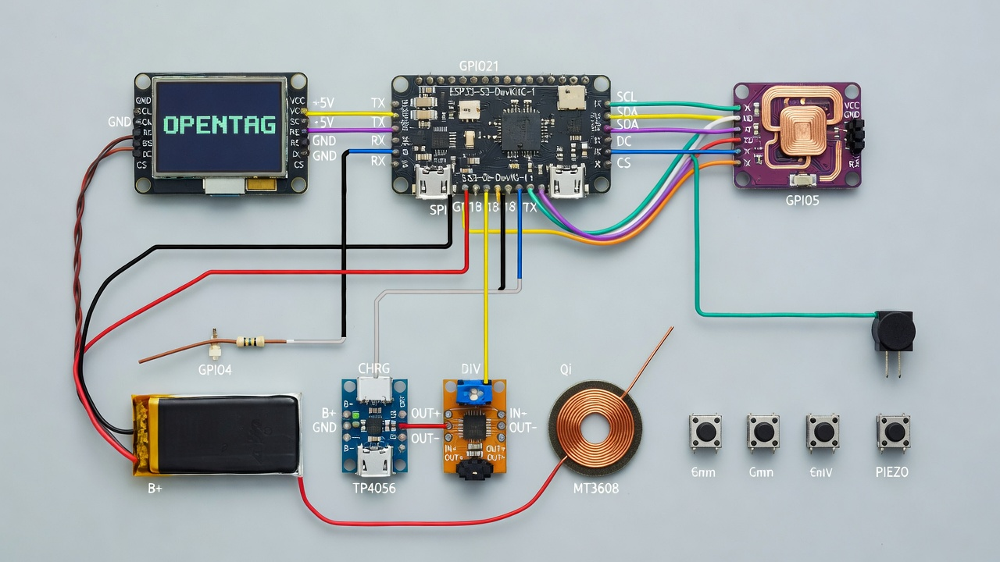

# OpenTag carrier PCB — wiring & assembly guide



*Pictorial overview: the modules and their color-coded hookups as assembled
on the carrier PCB (full signal truth in the tables below — the drawing is
illustrative).*

`opentag-carrier.kicad_pcb` (regenerate with `python3 hardware/pcb/generate_carrier_pcb.py`,
which self-checks connectivity and clearance before writing the file) is a
90 × 60 mm, 2-layer, all-through-hole board. Two ways to fabricate it:

- **Gerbers (recommended):** send `hardware/pcb/gerbers/opentag-gerbers.zip`
  to any fab (JLCPCB, PCBWay, …). The generator writes and machine-verifies
  the set; the GND zones are not needed — power returns use explicit
  tracks, so the boards work unfilled.
- **KiCad:** view/order the `.kicad_pcb` in KiCad 6+; press **B** to fill
  the two GND zones before plotting your own Gerbers if you want the extra
  copper.

## What lives on the board

| Reference | Part | Notes |
| --- | --- | --- |
| J_DEVKIT | 2 × 1×22 female headers, 2.54 mm | ESP32-S3-DevKitC-1 socket (rows 22.86 mm apart, exact Espressif geometry) |
| J_OLED | 1 × 1×7 female header | 1.3" SSD1351 OLED module (pin 1 = GND, square pad) |
| J_KILLER | 1 × 1×4 male header | PN532Killer J4 via 4 F–F Dupont jumpers |
| SW_BTN ×4 | 6 × 6 mm tactile switches | UP / DOWN / OK / BACK |
| J_BAT | JST-PH-2 (2.0 mm) | LiPo cell input (**verify polarity!**) |
| J_CHG | 1 × 1×4 male header | TP4056 module: B+ B− OUT+ OUT− |
| J_BOOST | 1 × 1×4 male header | MT3608 module: IN+ IN− OUT− OUT+ |
| SW_PWR | SPDT mini toggle (3 pads, 2.54 row) | MTS-102 style, ≥1 A |
| D1 | 1N5819 (DO-41, 10.16 mm) | **banded (K) end toward the west pad**, marked in silk |
| MH ×4 | Ø3.2 NPTH | M3 standoffs |

## Orientation

- **DevKitC pin 1** (3V3, marked on the DevKit silk) goes to the **square pad**
  at the **north-west** corner of the socket. The DevKit's USB connectors end
  up facing **west** (toward the board edge with the two GND/5V pins).
- The OLED header's square pad (pin 1, GND) is on the west end.
- Solder the DevKit female headers from the **top** side; the headers mount on
  the bottom so the DevKit hangs under the carrier.

## Power chain (verify each stage before connecting the next!)

```
LiPo cell ── J_BAT ─┬─ J_CHG B+/B─ ── TP4056 B+/B─      (charging, USB-C in —
                                                        through the bolt-marked
                                                        charge port on the west
                                                        wall of the shell)
                    │
        TP4056 OUT+ ─┴─ SW_PWR (pads 1→2) ── J_BOOST IN+
        TP4056 OUT─ ─── GND ─────────────── J_BOOST IN─
        MT3608 OUT+ ── D1 (anode→cathode) ── +5V rail ── DevKitC J1-21 (5V)
        MT3608 OUT─ ─── GND ─────────────── DevKitC J1-22 / J3-1
        DevKitC 3V3 (J1-1/2) ── OLED VCC + Killer VCC
```

1. Set the MT3608 potentiometer to **5.0–5.1 V before** connecting anything
   downstream (measure at its OUT+/OUT− with the input powered from USB).
2. Check the battery polarity at J_BAT before plugging the cell in — JST-PH
   leads vary between vendors.
3. The TP4056 and MT3608 modules connect with four wires each; their pads are
   SMD edge pads on the modules (solder wires or pin headers to them).
4. Seat the TP4056 at the **west end** of the shell's power tray, USB-C jack
   first through the notched wall, so the jack lines up with the charge-port
   slot (marked by the engraved lightning bolt on the outside) and its CHG /
   STDBY LEDs face the opening — charging then works with the case closed
   and the LEDs peek through the same slot. The MT3608 goes east of it.

## Wireless charging (optional)

A Qi receiver module makes the OpenTag charge on any Qi pad — no firmware
change required (the TP4056 still runs the charge, so the port-slot LEDs and
the light pipe behave exactly as over USB-C). A matching **transmitter**
turns the printed desk stand into a charging dock: the stand's rear panel
carries an engraved ring + bolt on its back face — stick a 5 V Qi
transmitter coil (⌀ ≤ 40 mm, ferrite-backed) on that mark, wired to a 5 V
supply, and the docked device charges in place. The mark is centred under
the docked device's receiver coil as far up the 105 mm panel as it fits,
but the ~10° lean offsets the two coils by ~15 mm, so expect a gentle
charge rate rather than full power.

```
Qi receiver OUT+ ── D2 (anode→cathode) ── TP4056 VCC (USB-C jack VBUS)
Qi receiver OUT─ ─────────────────────── GND
TP4056 /CHRG (pin 7 = CHRG LED cathode) ── R2 22k ── J3-18 (GPIO21)
```

- Use a **5 V receiver** with a **⌀ ≤ 40 mm ferrite-backed coil** and bare
  leads. Stick the coil flat on the back plate **under the battery**, on the
  engraved-ring side (the ring + bolt on the outside mark the pad spot),
  battery on top of the coil. Keep it east of the tap halo — metal near the
  Killer's antenna costs read range.
- Why the ring sits at the battery bay (the lower-right of the back when
  the device is held normally) and not the upper-left: the upper-left of
  the back plate is fully occupied — carrier-PCB standoffs and button
  posts, the 56 × 30 mm service window over the DevKitC, and the DevKitC
  itself (USB end west) sit there, leaving no ⌀ 40 mm clear circle. The
  battery bay is the only zone that fits the coil *and* keeps its copper
  away from the NFC antenna; the battery then lies on top of the coil as
  the coupling spacer.
- D2 (a second 1N5819) stops the jack's 5 V from back-driving the receiver
  when you charge over USB-C. With the pad alone the TP4056 sees ~4.6 V,
  which is plenty for the ~0.5 A the small coil delivers.
- The 22 kΩ sense wire (R2) is optional: with it, the firmware lights a
  small bolt icon at the top-right of the screen while the TP4056 reports
  charging — a quick "is the pad actually coupled?" check. An unwired
  GPIO21 reads HIGH (no bolt) by design.

## Signals

| Net | From | To | DevKit pin (GPIO) |
| --- | --- | --- | --- |
| ESP_TX | J1-10 (GPIO17, U1TXD) | J_KILLER pin 3 (**TX**) → Killer J4 **RX** (pin 9) | 10 / 17 |
| ESP_RX | J1-11 (GPIO18, U1RXD) | J_KILLER pin 4 (**RX**) → Killer J4 **TX** (pin 8) | 11 / 18 |
| BTN_UP | J3-6 (GPIO42) | UP button | 6 / 42 |
| BTN_DOWN | J3-5 (GPIO2) | DOWN button | 5 / 2 |
| BTN_OK | J3-4 (GPIO1) | OK button | 4 / 1 |
| BTN_BACK | J1-19 (GPIO13) | BACK button (cancel / exit) | 19 / 13 |
| OLED_SCK | J1-18 (GPIO12) | OLED SCL | 18 / 12 |
| OLED_MOSI | J1-17 (GPIO11) | OLED SDA | 17 / 11 |
| OLED_RST | J1-12 (GPIO8) | OLED RES | 12 / 8 |
| OLED_DC | J1-15 (GPIO9) | OLED DC | 15 / 9 |
| OLED_CS | J1-16 (GPIO10) | OLED CS | 16 / 10 |
| CHG_SENSE | TP4056 /CHRG (pin 7), via R2 22k | J3-18 (GPIO21) | 18 / 21 |
| BATT_SENSE | B+ ─ 100k ─┬ (midpoint) ─ 100k ─ GND | J1-4 (GPIO4) | 4 / 4 |
| PIEZO | passive buzzer + pin | J1-5 (GPIO5), other pin to GND | 5 / 5 |
| +3V3 | J1-1/2 | OLED VCC, Killer 3V3 | — |
| +5V | J1-21 (via D1) | DevKit 5V pin | — |

- Button pins: both pads on each side of every switch are paralleled on the
  PCB, so any 6 × 6 mm tactile with the standard 6.5 × 4.5 mm pin pattern
  works regardless of internal pin pairing.
- J1-19 (GPIO13, the SPI MISO pin) is the BACK button, not a bus pin: the
  OLED is write-only so MISO is unused, and the firmware never passes it to
  `SPI.begin()`. BACK cancels the tag-scan/write screens, stops emulation,
  skips the lock confirm and exits the amiibo library back to the menu.
- The PN532Killer runs on 3.3 V only. Its J4 header: pin 9 = RX, pin 8 = TX
  (3.3 V TTL), plus GND and VCC — **verify against your board's silkscreen.**

## Optional wiring: battery gauge + piezo

```
B+ ── 100k ──┬── 100k ── GND      (divider draws ~18 µA; fit only if you
             └── J1-4 (GPIO4)      want the % gauge / auto-off)
GPIO5 (J1-5) ── piezo(+) ── piezo(−) ── GND
```

- With the divider fitted, the OLED header shows the cell percentage
  (grey; red at/below 15 %). Below 3.35 V the device warns once; below
  3.25 V sustained 30 s it powers off cleanly. Without the divider the
  firmware detects the floating pin (raw < ~0.1 V) and hides the gauge.
- The piezo is a **passive** buzzer (no oscillator): the firmware drives it
  with `tone()` chirps on tag backup, verified writes, pairing completion
  and the low-battery warning. Unwired = silent, no errors.
- Note the /CHRG sense line (R2, 22 kΩ) stays as documented above — the
  two features are independent of each other and of the Qi option.

## Bring-up checklist

1. Continuity-check GND between DevKit socket, OLED, Killer and power headers.
2. With SW_PWR off, plug the DevKit in and confirm 5 V at J1-21 only when the
   boost output is enabled and D1 is installed.
3. Flash firmware over the DevKit's USB; set the MT3608 to 5.05 V; then power
   from the battery.
4. On boot the OLED shows OPENTAG; the menu reports the PN532Killer state
   (`PN532Killer absent` if UART probing failed — check TX/RX swap first).
